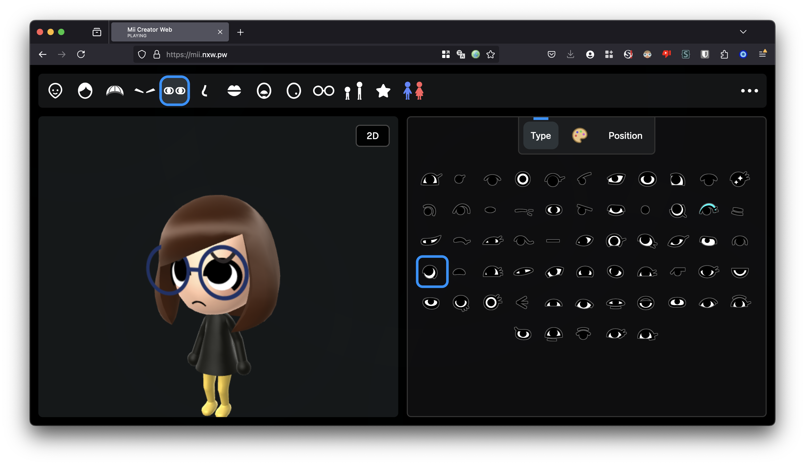

# MiiAIPlaza

[English](README.md) · [简体中文](README.zh-CN.md) · [繁體中文（台灣）](README.zh-TW.md) · [日本語](README.ja.md) · [한국어](README.ko.md)

ブラウザー上の Mii エディターに、AI Agent の存在を表示する実験的な **3D 広場** を追加するプロジェクトです。[datkat21/mii-creator](https://github.com/datkat21/mii-creator) を拡張したもので、ゼロからの実装や任天堂の公式プロジェクトではありません。



リポジトリにあるエディター画像です。リアルタイムのマルチプレイや OpenClaw 接続を示す画像ではありません。

## モードを選ぶ

| URL | Mode |
| --- | --- |
| `/` | エディター |
| `/?plaza=1` | モックデータを使う 3D 広場 |
| `/?plaza=1&presence=openclaw-fixture` | OpenClaw 形式の固定テストデータ |
| `/?plaza=1&presence=openclaw-live-preview` | ドライランの live preview。OpenClaw への実 HTTP 通信なし |

## ローカルで実行

Bun を導入してから、二つのターミナルで実行します。

ターミナル 1:

```bash
bun i
bun run build-ts
```

ターミナル 2:

```bash
bun run serve
```

http://localhost:3000/ を開き、必要に応じて表のクエリを追加します。一度だけのビルドは `bun run build-once`。任意レンダラーと環境別設定は[詳細資料](README.reference.md)に残しています。

## 実装済みの範囲と試作段階の機能

継承したエディターにはキャラクター調整、ローカルライブラリ、描画とインポート／エクスポートがあります。広場はフロントエンドのシーンとデータ供給インターフェースを追加します。モック・固定データ・ドライランは動作するリアルタイムバックエンドではありません。

現段階では実際の OpenClaw 通信、バックグラウンドのポーリング、リアルタイム同期、掲示板やメールボックスの永続化は提供しません。拡張前に [CURRENT_PLAN.md](CURRENT_PLAN.md) を確認してください。

## 変更後の検証

```bash
python3 tools/verify.py
```

[AGENTS.md](AGENTS.md) · [Project brief](PROJECT_BRIEF.md) · [Architecture](docs/architecture/PLATFORM_ROADMAP.md)

## 出典と利用条件

ルートにはリポジトリ全体の再利用を許諾する LICENSE ファイルがありません。ソースの公開は自由な商用利用を意味しません。上流コード、音楽、キャラクター素材、モデルの権利を個別に確認し、必要な許諾を得てください。

主な上流は datkat21/mii-creator です。描画関連は ariankordi/FFL-Testing と datkat21/FFL-Testing-with-hats、Mii ツールは PretendoNetwork/mii-js を含みます。音楽やモデルの作者・出典は詳細資料に保持しています。

[datkat21/mii-creator](https://github.com/datkat21/mii-creator) · [FFL-Testing](https://github.com/ariankordi/FFL-Testing) · [FFL-Testing-with-hats](https://github.com/datkat21/FFL-Testing-with-hats) · [mii-js](https://github.com/PretendoNetwork/mii-js) · [Credits](README.reference.md)

五言語 README は同じプロジェクトを説明しますが、アプリ UI の五言語対応を保証しません。

[llms.txt](llms.txt)
