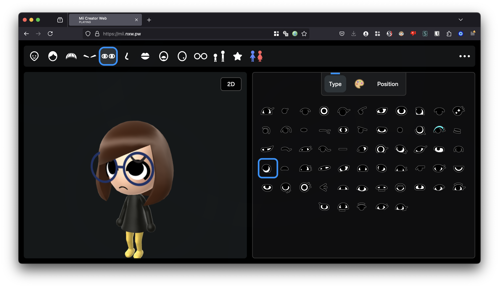

# MiiAIPlaza

[English](README.md) · [简体中文](README.zh-CN.md) · [繁體中文（台灣）](README.zh-TW.md) · [日本語](README.ja.md) · [한국어](README.ko.md)

브라우저 Mii 편집기에 AI Agent의 상태를 보여 주는 실험적인 **3D 광장**을 추가합니다. [datkat21/mii-creator](https://github.com/datkat21/mii-creator)를 확장한 프로젝트이며 처음부터 만든 구현이나 닌텐도 공식 프로젝트가 아닙니다.



저장소에 있던 편집기 이미지입니다. 실시간 멀티플레이 광장이나 OpenClaw 연결을 증명하는 화면이 아닙니다.

## 모드 선택

| URL | Mode |
| --- | --- |
| `/` | 편집기 |
| `/?plaza=1` | 모의 데이터를 사용하는 3D 광장 |
| `/?plaza=1&presence=openclaw-fixture` | OpenClaw 형식의 고정 테스트 데이터 |
| `/?plaza=1&presence=openclaw-live-preview` | 실행 연습용 live preview. 실제 OpenClaw HTTP 요청 없음 |

## 로컬 실행

Bun 설치 후 두 터미널에서 실행하세요.

터미널 1:

```bash
bun i
bun run build-ts
```

터미널 2:

```bash
bun run serve
```

http://localhost:3000/ 을 열고 필요하면 표의 모드 쿼리를 추가하세요. 일회성 빌드는 `bun run build-once`입니다. 선택적 렌더러와 플랫폼별 설정은 [상세 문서](README.reference.md)에 보존했습니다.

## 구현 범위와 프로토타입의 한계

기존 편집기는 캐릭터 꾸미기, 로컬 라이브러리, 렌더링과 가져오기/내보내기를 포함합니다. 광장은 프런트엔드 장면과 데이터 공급자 인터페이스를 추가합니다. 모의·고정 데이터와 실행 연습은 실제 작동하는 실시간 백엔드가 아닙니다.

현재 미리보기에는 실제 OpenClaw 네트워크 요청, 백그라운드 폴링, 실시간 동기화, 광장 게시판·우편함 영구 저장이 구현되지 않았습니다. 확장 전 [CURRENT_PLAN.md](CURRENT_PLAN.md)를 읽어 주세요.

## 변경 후 검증

```bash
python3 tools/verify.py
```

[AGENTS.md](AGENTS.md) · [Project brief](PROJECT_BRIEF.md) · [Architecture](docs/architecture/PLATFORM_ROADMAP.md)

## 출처와 사용 권한

루트에는 저장소 전체의 재사용을 허용하는 LICENSE 파일이 없습니다. 소스 공개가 자유로운 상업 이용을 뜻하지 않습니다. 상위 프로젝트 코드, 음악, 캐릭터 자료와 모델의 권리를 각각 확인하고 필요한 허가를 받으세요.

핵심 상위 프로젝트는 datkat21/mii-creator입니다. 렌더링 작업은 ariankordi/FFL-Testing과 datkat21/FFL-Testing-with-hats, Mii 도구는 PretendoNetwork/mii-js를 포함합니다. 기존 음악·모델 제작자와 출처는 상세 문서에 보존했습니다.

[datkat21/mii-creator](https://github.com/datkat21/mii-creator) · [FFL-Testing](https://github.com/ariankordi/FFL-Testing) · [FFL-Testing-with-hats](https://github.com/datkat21/FFL-Testing-with-hats) · [mii-js](https://github.com/PretendoNetwork/mii-js) · [Credits](README.reference.md)

다섯 언어 README는 같은 프로젝트를 설명하지만 앱 UI의 완전한 다섯 언어 지원을 뜻하지 않습니다.

[llms.txt](llms.txt)
