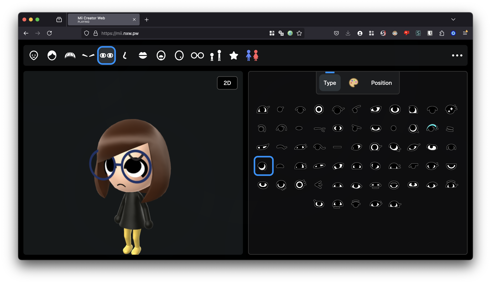

# MiiAIPlaza

[English](README.md) · [简体中文](README.zh-CN.md) · [繁體中文（台灣）](README.zh-TW.md) · [日本語](README.ja.md) · [한국어](README.ko.md)

A browser Mii editor with an experimental **3D plaza for AI-agent presence**. This repository extends [datkat21/mii-creator](https://github.com/datkat21/mii-creator); it is not a ground-up replacement or an official Nintendo project.



This repository image shows the inherited editor, not proof of a live multiplayer plaza or OpenClaw connection.

## Choose a mode

| URL | Mode |
| --- | --- |
| `/` | Editor |
| `/?plaza=1` | 3D plaza using mock data |
| `/?plaza=1&presence=openclaw-fixture` | OpenClaw-shaped fixture data |
| `/?plaza=1&presence=openclaw-live-preview` | Dry-run live preview; no actual OpenClaw HTTP requests |

## Run locally

Install Bun first. In two terminals:

Terminal 1:

```bash
bun i
bun run build-ts
```

Terminal 2:

```bash
bun run serve
```

Open http://localhost:3000/ and append a mode query above when needed. For a one-time build use `bun run build-once`. Optional renderer setup and platform-specific instructions remain in the [detailed guide](README.reference.md).

## What works, what is still a prototype

The inherited editor includes character customization, a local library, rendering and import/export workflows. The plaza adds a frontend scene and provider seams. Mock, fixture and dry-run previews are not a working realtime backend.

Actual OpenClaw network fetching, background polling, realtime synchronization and persistent plaza board/mailbox data are not delivered by the current preview. Read [CURRENT_PLAN.md](CURRENT_PLAN.md) before extending it.

## Validate a change

```bash
python3 tools/verify.py
```

[AGENTS.md](AGENTS.md) · [Project brief](PROJECT_BRIEF.md) · [Architecture](docs/architecture/PLATFORM_ROADMAP.md)

## Attribution and reuse

The root currently has no LICENSE file granting a repository-wide reuse license. Public source access does not imply unrestricted commercial reuse. Check upstream code, music, character assets and models separately; obtain permission where required.

Core upstream: datkat21/mii-creator. Rendering work includes ariankordi/FFL-Testing and datkat21/FFL-Testing-with-hats; Mii tooling includes PretendoNetwork/mii-js. The retained detailed guide lists the original music/model contributors and sources.

[datkat21/mii-creator](https://github.com/datkat21/mii-creator) · [FFL-Testing](https://github.com/ariankordi/FFL-Testing) · [FFL-Testing-with-hats](https://github.com/datkat21/FFL-Testing-with-hats) · [mii-js](https://github.com/PretendoNetwork/mii-js) · [Credits](README.reference.md)

These five READMEs describe the same project; they do not assert that the application UI has five complete localizations.

[llms.txt](llms.txt)
