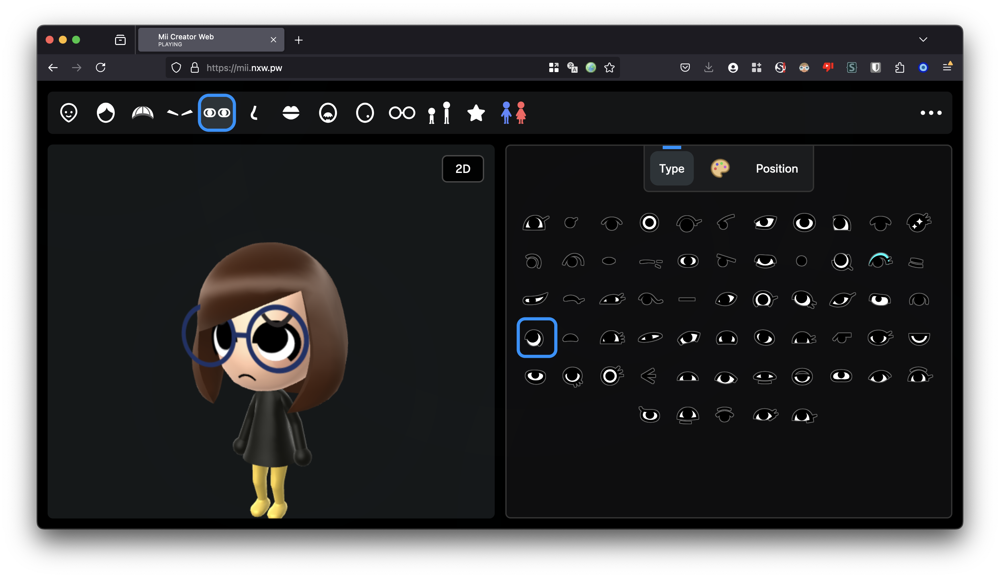

# MiiAIPlaza

[English](README.md) · [简体中文](README.zh-CN.md) · [繁體中文（台灣）](README.zh-TW.md) · [日本語](README.ja.md) · [한국어](README.ko.md)

浏览器 Mii 编辑器，加上用于展示 AI Agent 在线状态的实验性 **3D 广场**。本项目扩展自 [datkat21/mii-creator](https://github.com/datkat21/mii-creator)，不是从零重写，也不是任天堂官方项目。



这是仓库已有的编辑器图片，不是实时多人广场或 OpenClaw 已联网的证明。

## 选择体验入口

| URL | Mode |
| --- | --- |
| `/` | 编辑器 |
| `/?plaza=1` | 使用模拟数据的 3D 广场 |
| `/?plaza=1&presence=openclaw-fixture` | OpenClaw 结构的固定测试数据 |
| `/?plaza=1&presence=openclaw-live-preview` | 演练式 live preview，不发送实际 OpenClaw HTTP 请求 |

## 本地运行

先安装 Bun，再使用两个终端：

终端 1:

```bash
bun i
bun run build-ts
```

终端 2:

```bash
bun run serve
```

打开 http://localhost:3000/，需要时加上表中的模式参数。单次构建使用 `bun run build-once`。可选渲染器和平台专用配置保留在[详细说明](README.reference.md)。

## 哪些能用，哪些还是原型

继承的编辑器包含角色自定义、本地角色库、渲染和导入导出流程。广场新增前端场景与数据提供器接口；模拟数据、固定样本与演练预览不等于可工作的实时后端。

当前预览尚未实现实际 OpenClaw 网络抓取、后台轮询、实时同步或广场留言板/邮箱持久化。继续开发前请读 [CURRENT_PLAN.md](CURRENT_PLAN.md)。

## 修改后验证

```bash
python3 tools/verify.py
```

[AGENTS.md](AGENTS.md) · [Project brief](PROJECT_BRIEF.md) · [Architecture](docs/architecture/PLATFORM_ROADMAP.md)

## 归属与使用许可

仓库根目录目前没有授予整个项目统一使用权的 LICENSE。源码公开不等于可任意商用。上游代码、音乐、角色素材和模型需分别核对权利，必要时取得许可。

核心上游为 datkat21/mii-creator。渲染工作包含 ariankordi/FFL-Testing 与 datkat21/FFL-Testing-with-hats；Mii 工具包含 PretendoNetwork/mii-js。原音乐、模型作者与来源完整保留在详细说明中。

[datkat21/mii-creator](https://github.com/datkat21/mii-creator) · [FFL-Testing](https://github.com/ariankordi/FFL-Testing) · [FFL-Testing-with-hats](https://github.com/datkat21/FFL-Testing-with-hats) · [mii-js](https://github.com/PretendoNetwork/mii-js) · [Credits](README.reference.md)

五语 README 介绍的是同一项目，不代表应用界面已完成五种语言本地化。

[llms.txt](llms.txt)
