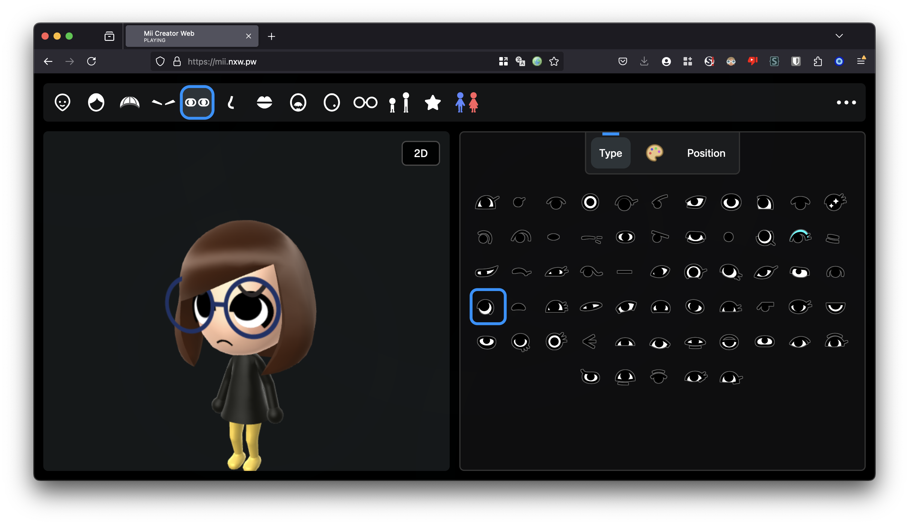

# MiiAIPlaza

[English](README.md) · [简体中文](README.zh-CN.md) · [繁體中文（台灣）](README.zh-TW.md) · [日本語](README.ja.md) · [한국어](README.ko.md)

瀏覽器 Mii 編輯器，加上展示 AI Agent 在線狀態的實驗性 **3D 廣場**。本專案延伸自 [datkat21/mii-creator](https://github.com/datkat21/mii-creator)，並非從零重寫，也不是任天堂官方專案。



這是儲存庫原有的編輯器圖片，不能當成即時多人廣場或 OpenClaw 已連線的證明。

## 選擇體驗入口

| URL | Mode |
| --- | --- |
| `/` | 編輯器 |
| `/?plaza=1` | 使用模擬資料的 3D 廣場 |
| `/?plaza=1&presence=openclaw-fixture` | 符合 OpenClaw 結構的固定測試資料 |
| `/?plaza=1&presence=openclaw-live-preview` | 演練式 live preview，不發送實際 OpenClaw HTTP 請求 |

## 在本機執行

先安裝 Bun，再使用兩個終端機：

終端機 1:

```bash
bun i
bun run build-ts
```

終端機 2:

```bash
bun run serve
```

開啟 http://localhost:3000/，需要時加上表中的模式參數。單次建置使用 `bun run build-once`。選用算圖器及平台專用設定保留在[詳細說明](README.reference.md)。

## 哪些可用，哪些仍是原型

沿用的編輯器包含角色自訂、本機角色庫、算圖及匯入匯出流程。廣場新增前端場景與資料提供者介面；模擬資料、固定樣本及演練預覽不等於已可運作的即時後端。

目前預覽尚未實作 OpenClaw 實際網路擷取、背景輪詢、即時同步或廣場留言板／信箱的持久化儲存。擴充前請閱讀 [CURRENT_PLAN.md](CURRENT_PLAN.md)。

## 修改後驗證

```bash
python3 tools/verify.py
```

[AGENTS.md](AGENTS.md) · [Project brief](PROJECT_BRIEF.md) · [Architecture](docs/architecture/PLATFORM_ROADMAP.md)

## 來源與使用授權

儲存庫根目錄目前沒有授予全專案統一使用權的 LICENSE。原始碼公開不代表可任意商用。上游程式碼、音樂、角色素材與模型須分別確認權利，必要時取得授權。

核心上游為 datkat21/mii-creator。算圖工作包含 ariankordi/FFL-Testing 與 datkat21/FFL-Testing-with-hats；Mii 工具包含 PretendoNetwork/mii-js。原音樂、模型作者及來源完整保留在詳細說明中。

[datkat21/mii-creator](https://github.com/datkat21/mii-creator) · [FFL-Testing](https://github.com/ariankordi/FFL-Testing) · [FFL-Testing-with-hats](https://github.com/datkat21/FFL-Testing-with-hats) · [mii-js](https://github.com/PretendoNetwork/mii-js) · [Credits](README.reference.md)

五語 README 介紹同一專案，不代表應用程式介面已完成五種語言在地化。

[llms.txt](llms.txt)
